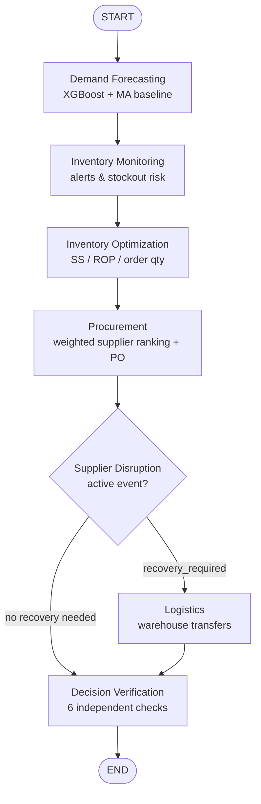

# Architecture

## 1. Layers

```
┌──────────────────────────────────────────────────────────────────────────┐
│ LAYER 1 · PRESENTATION — Next.js 15 App Router + React + TypeScript      │
│ Executive dashboard · Forecasting · Inventory · Procurement ·           │
│ Disruption · Multi-agent monitoring · Reports (Recharts + Lucide)        │
└───────────────────────────────┬──────────────────────────────────────────┘
                                │ REST/JSON (CORS, NEXT_PUBLIC_API_URL)
┌───────────────────────────────▼──────────────────────────────────────────┐
│ LAYER 2 · BACKEND — FastAPI (Pydantic v2, SQLAlchemy 2, OpenAPI docs)    │
│ routers → services → domain modules; background execution + status API   │
└───────────────────────────────┬──────────────────────────────────────────┘
                                │
┌───────────────────────────────▼──────────────────────────────────────────┐
│ LAYER 3 · AGENT ORCHESTRATION — LangGraph StateGraph                     │
│ 7 specialized agents over one typed shared state, conditional routing,   │
│ retry + logging + execution/result persistence                           │
└───────────────────────────────┬──────────────────────────────────────────┘
                                │
┌───────────────────────────────▼──────────────────────────────────────────┐
│ LAYER 4 · AI & BUSINESS INTELLIGENCE (pure Python, no LLM required)      │
│ forecasting/ · inventory/ · procurement/ · decision verification         │
└───────────────────────────────┬──────────────────────────────────────────┘
                                │
┌───────────────────────────────▼──────────────────────────────────────────┐
│ LAYER 5 · PERSISTENCE — Supabase PostgreSQL (SQLAlchemy models, 14 tables)│
└──────────────────────────────────────────────────────────────────────────┘
```

## 2. Repository layout

```
supply-chain-ai/
├── frontend/                 Next.js dashboard (9 routes: overview, forecasting,
│                             inventory, warehouses, procurement, disruptions,
│                             agents, reports, settings)
├── backend/
│   ├── main.py               FastAPI app, CORS, lifespan, /health
│   ├── api/                  routers per domain
│   ├── schemas/              Pydantic request/response models
│   ├── services/             analytics + business orchestration services
│   ├── models/models.py      14 SQLAlchemy tables
│   ├── database/             engine/session, seed, sample-data generator
│   └── artifacts/            trained model artifacts (git-ignored)
├── agents/                   state, 7 agents, graph, orchestrator, runtime
├── forecasting/              preprocessing, features, train, predict, evaluation
├── inventory/                calculations, transfers/allocation
├── procurement/              supplier_selection, purchase_orders, disruptions
├── tests/                    pytest unit + integration + e2e
├── data/sample/              synthetic CSV datasets
├── docs/                     architecture, API, deployment, test report
├── api/index.py              Vercel Python function entrypoint
└── vercel.json               Vercel build/route config for the API
```

Separation is strict: the domain packages (`forecasting`, `inventory`,
`procurement`) never import FastAPI or SQLAlchemy models, so they can be unit
tested in isolation. `backend/services` is the only place that joins domain logic
to persistence, and `agents` is the only place that orchestrates across domains.

## 3. Multi-agent workflow



Every node calls real business code and writes to PostgreSQL:

| Agent | Reads | Writes |
| --- | --- | --- |
| Demand Forecasting | `sales_history`, artifacts | `demand_forecasts` |
| Inventory Monitoring | stock + forecasts + lead times | – (state + log) |
| Inventory Optimization | stock, forecasts, service level | `inventory_recommendations` |
| Procurement | recommendations, `supplier_products` | `purchase_orders` |
| Supplier Disruption | `suppliers`, `supplier_disruptions` | `supplier_disruptions` |
| Logistics | stock + recommendations | `warehouse_transfers` |
| Decision Verification | everything above + stock re-read | `workflow_results` |

LangGraph state is a `TypedDict` (`agents/state.py`). Node failures are retried
once by `TimedAgent`, then the execution is marked `failed` with the error text
persisted, so a broken run is never silently reported as a success.

## 4. Business formulas and assumptions

| Quantity | Formula | Notes |
| --- | --- | --- |
| Available stock | `current − reserved` (≥ 0) | reserved is committed demand |
| Safety stock | `Z(service) × σ_demand × √lead_time` | σ from the last 42 daily observations |
| Reorder point | `avg_daily_demand × lead_time + safety_stock` | lead time from the fastest active supplier |
| Target stock | `avg_daily_demand × (lead_time + review_period) + safety_stock` | order-up-to level |
| Recommended order | `max(target − available − incoming, 0)` | rounded up to the supplier MOQ, capped by warehouse headroom |
| Transferable surplus | `available + incoming − safety_stock` (≥ 0) | a source never drops below its safety stock |
| Supplier score | `Σ wᵢ · normalised(criterion) × 100` | min-max, cost & lead time inverted, weights renormalised |
| WAPE | `Σ|y − ŷ| / Σ|y|` | zero-demand series return 0.0 |

Units are consistent throughout: quantities are units, lead times and review
periods are calendar days, prices are currency per unit. Demand is independent
across days (normal approximation), which is documented as a modelling assumption.

## 5. Forecasting design

* **Grain**: one daily series per product aggregated across warehouses (the spec's
  product-wise requirement). Preprocessing also exposes per-(product, warehouse)
  aggregation for warehouse-level analysis.
* **Features**: day, month, ISO week, day-of-week, quarter, weekend flag, lags
  1/7/14, rolling means 7/14/30. All lags and rolling windows are shifted so a row
  for day *t* only uses data up to *t−1*.
* **Split**: chronological — the last 28 days are held out; no shuffling.
* **Models**: `XGBRegressor` (300 trees, depth 4, lr 0.07) versus a seasonal-naive
  moving-average baseline (mean of the previous 7 observed days, walked forward).
* **Fallbacks**: fewer than 60 daily observations or 40 supervised rows →
  no training, prediction uses the moving-average baseline and reports
  `model = "moving_average_fallback"`. The dashboard shows which model produced
  each forecast.
* **Artifacts**: `joblib` files in `MODEL_ARTIFACT_DIR` plus `metrics.json`.
  Training is a separate offline step (`POST /api/forecast/train`, background by
  default, or `python -m forecasting.train` style invocation via the service).
  Prediction only loads artifacts; the workflow trains missing artifacts once.
* **Inference**: recursive one-step-at-a-time multi-step forecasting (7/14/30 days)
  with predictions fed back as lags; predictions clipped at 0.

## 6. Data model

14 tables: `products`, `warehouses`, `inventory`, `sales_history`, `suppliers`,
`supplier_products`, `purchase_orders`, `demand_forecasts`,
`inventory_recommendations`, `warehouse_transfers`, `supplier_disruptions`,
`agent_executions`, `agent_logs`, `workflow_results`.

Key constraints and indexes:

* `inventory (product_id, warehouse_id)` unique; index on `warehouse_id`.
* `sales_history (sale_date, product_id, warehouse_id)` unique; indexes on
  `(product_id, sale_date)` and `(warehouse_id, sale_date)`.
* `supplier_products (supplier_id, product_id)` unique; index on `product_id`.
* `demand_forecasts (product_id, forecast_date)`, `agent_logs (execution_id, step_index)`
  indexed for the read paths the dashboard uses.

## 7. Execution and serverless constraints

`POST /api/agents/execute` persists the execution (status `queued`), then dispatches
the graph either synchronously (`wait_for_completion=true`) or to a bounded thread
pool. `GET /api/agents/status/{id}` reports progress from the persisted logs, so a
client can poll and the UI can render a live timeline.

Vercel functions cannot be relied on to keep a background thread alive after the
response, so the deployment guide uses synchronous execution (workflows take a few
seconds on this dataset) or an external worker that calls `run_workflow` for a
queued execution. This limitation is explicit rather than hidden.

## 8. Things that are deliberately NOT done

* No LLM is called anywhere in the decision path. There is no key to configure and
  no paid API needed for forecasting, ranking, verification or recovery.
* Purchase orders and supplier disruptions are **simulated planning records**;
  nothing is transmitted to a supplier.
* Authentication is out of scope for this capstone; the API is expected to run on a
  private deployment or behind platform-level access controls.
